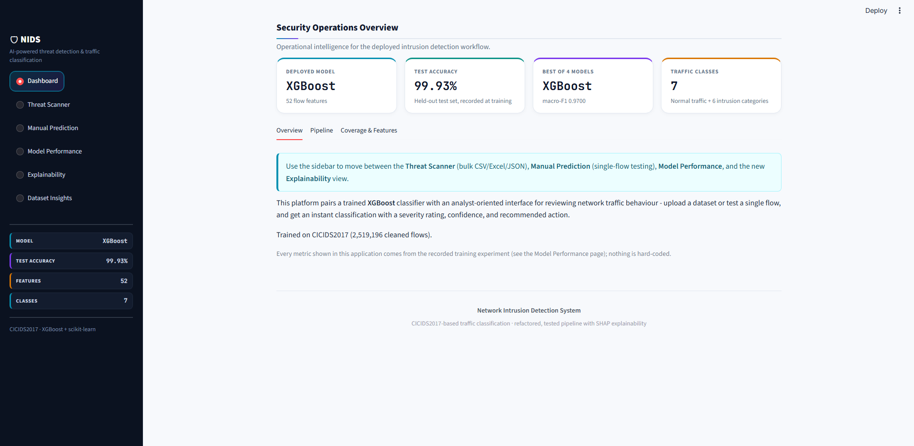
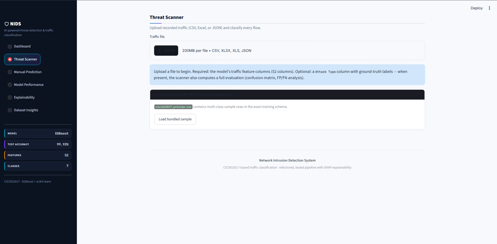
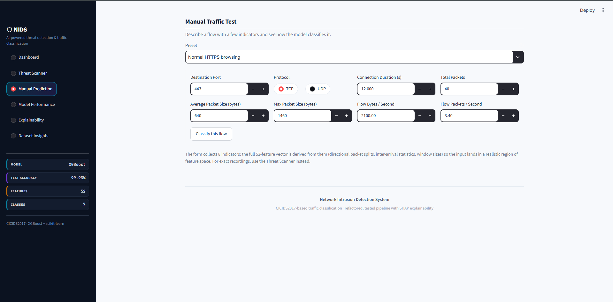
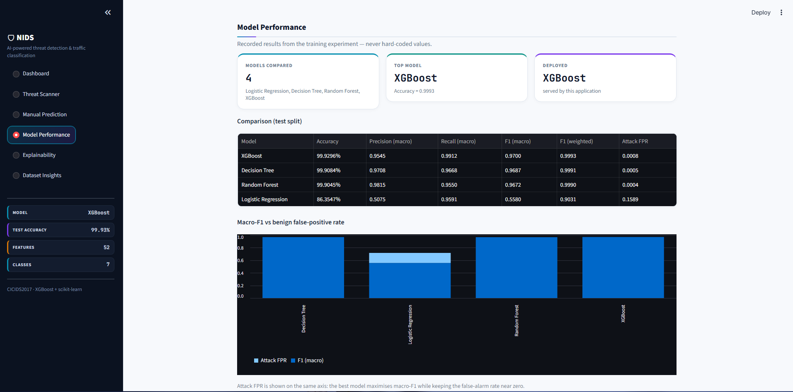
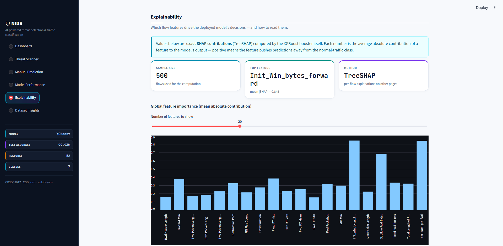

# Network Intrusion Detection System

A machine learning-based Network Intrusion Detection System (NIDS) that classifies network traffic using the CICIDS2017 dataset. Built with Python, XGBoost, and Streamlit, the application provides an interactive dashboard for traffic classification, model evaluation, and SHAP-based explainability.

**Tech Stack:** Python · XGBoost · Scikit-learn · Pandas · SHAP · Streamlit

## Application Preview

### Dashboard


### Threat Scanner


### Manual Prediction


### Model Performance


### Explainability


### Explainable AI

Explore feature importance and understand how traffic features influence model predictions using SHAP.


## Key Features

- **Traffic Classification:** Classifies network traffic into seven categories.
- **Threat Scanner:** Supports CSV, Excel, and JSON traffic files.
- **Manual Prediction:** Tests individual network flows using configurable inputs.
- **Model Comparison:** Compares Logistic Regression, Decision Tree, Random Forest, and XGBoost.
- **Explainable AI:** Uses SHAP to explain model predictions.
- **Performance Dashboard:** Displays recorded classification metrics and model comparisons.
- **Dataset Insights:** Provides information about the processed dataset, features, and class distribution.

## Supported Traffic Categories

The application supports seven traffic categories:

- Normal Traffic
- DoS
- DDoS
- Port Scanning
- Bots
- Brute Force
- Web Attacks

## Model Performance

The following metrics are from the recorded test-split experiment.

| Model | Accuracy | Precision (Macro) | Recall (Macro) | F1 (Macro) | F1 (Weighted) | Attack FPR |
|---|---:|---:|---:|---:|---:|---:|
| **XGBoost** | **99.9296%** | 0.9545 | **0.9912** | **0.9700** | 0.9993 | 0.0008 |
| Decision Tree | 99.9084% | 0.9708 | 0.9668 | 0.9687 | 0.9991 | 0.0005 |
| Random Forest | 99.9045% | **0.9815** | 0.9550 | 0.9672 | 0.9990 | **0.0004** |
| Logistic Regression | 86.3547% | 0.5075 | 0.9591 | 0.5580 | 0.9031 | 0.1589 |

XGBoost achieved the highest recorded accuracy and macro F1-score. Random Forest achieved the highest macro precision and lowest reported Attack FPR.

These results describe the recorded experiment and should not be interpreted as a guarantee of equivalent performance on unseen or real-world network traffic.

## Project Architecture

```text
network-intrusion-detection-system/
├── app.py                  # Streamlit application entry point
├── config.py               # Project configuration
├── prepare_data.py         # Dataset preparation
├── train.py                # Training workflow
├── train_model.py          # Model-training entry point
├── requirements.txt        # Python dependencies
├── runtime.txt             # Runtime configuration
├── src/                    # Core processing and ML modules
├── ui/                     # Dashboard components and pages
├── models/                 # Saved model artifacts and comparisons
├── notebooks/              # Experiments and exploratory analysis
├── tests/                  # Automated tests
├── docs/                   # Project documentation
└── screenshots/             # Application screenshots
```

## Installation and Usage

### 1. Clone the repository

```bash
git clone https://github.com/krishpatel1220/network-intrusion-detection-system.git
cd network-intrusion-detection-system
```

### 2. Create a virtual environment

**Windows PowerShell:**

```powershell
python -m venv .venv
.\.venv\Scripts\Activate.ps1
```

### 3. Install dependencies

```bash
python -m pip install -r requirements.txt
```

### 4. Prepare the dataset and train models

If you need to regenerate the model artifacts, download the CICIDS2017 dataset from the Canadian Institute for Cybersecurity:

https://www.unb.ca/cic/datasets/ids-2017.html

Place the required CSV files in the expected `data/raw/` directory, then run:

```bash
python prepare_data.py
python train.py
```

Follow the scripts' configuration and output paths if they differ from these defaults.

### 5. Run the application

```bash
streamlit run app.py
```

Open the local URL printed in the terminal.

**Note:** The application requires its expected model artifacts and configuration files. Confirm that the required artifacts are available before launching it. Retraining is not necessary if the existing artifacts are compatible and ready to use.

## Running Tests

Install the project dependencies and run:

```bash
python -m pytest tests/
```

The test results depend on the environment, installed dependencies, and required test fixtures.

## Dataset

This project uses the CICIDS2017 dataset from the Canadian Institute for Cybersecurity.

The processed dataset used by the application contains approximately 2.52 million traffic records, 52 input features, and seven traffic categories.

The full dataset is not included in this repository. Users who want to reproduce the data-preparation and training workflow should obtain the dataset separately.

## Limitations

- CICIDS2017 may not represent current network traffic and attack patterns.
- Class imbalance can affect performance on less frequent attack categories.
- Benchmark performance does not guarantee equivalent performance on unseen networks.
- Predictions depend on the quality, schema, and distribution of the supplied traffic features.
- This project is intended for research and demonstration, not as a replacement for a production security monitoring system.

## Future Improvements

- Evaluate performance on additional intrusion-detection datasets.
- Investigate generalization to unseen traffic patterns.
- Expand automated testing and reproducibility checks.
- Improve integration with real-time network monitoring workflows.

## Author

**Krish Patel**

GitHub: https://github.com/krishpatel1220
